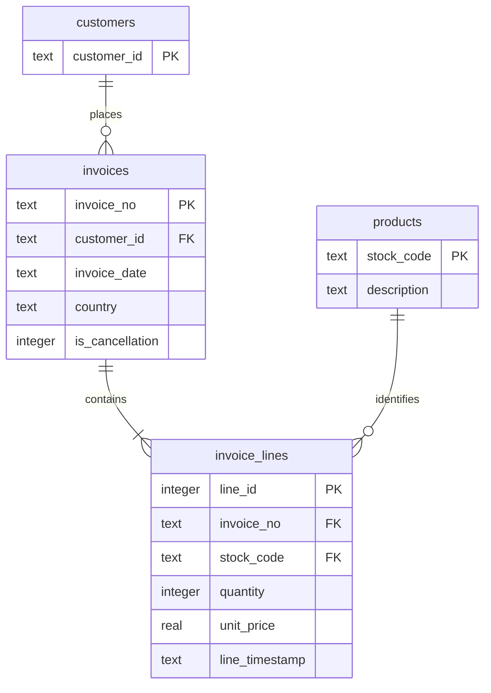

# Retail Lens

A SQL analytics application that turns the UCI Online Retail workbook into a
normalized, read-only reporting warehouse with revenue reconciliation,
customer segmentation, repeat-purchase analysis and monthly retention cohorts.

**Verified scale:** 541,909 source rows →
534,129 validated transaction lines,
23,796 invoice headers, 4,371 known customers
and 3,938 product codes. Historical transactions are in GBP.

## Features

- Deterministic ingestion with exact duplicate removal and explicit exclusions.
- Four normalized tables, foreign keys, indexes, and a reusable fact view.
- Eight parameterized SQL reports, including window-function RFM segmentation
  and a recursive calendar scaffold for retention cohorts.
- Revenue trend, return-value ratio, AOV, top products, countries, repeat buyers,
  transaction drilldown, date/country filters, SQL inspection and CSV exports.
- Anonymous transactions retained for revenue and excluded from known-customer
  segmentation. Returns remain in financial reporting.
- Atomic warehouse replacement, data-quality report and reconciliation tests.
- Responsive dashboard, read-only reporting connection and API documentation.

## Warehouse schema



## Run locally

Use **Python 3.12**. Open a terminal inside this repository.

Windows PowerShell, without changing execution policy:

```powershell
py -3.12 -m venv .venv
.venv\Scripts\python -m pip install -r requirements.txt
.venv\Scripts\python -m app.bootstrap
.venv\Scripts\python -m uvicorn app.main:app --host 127.0.0.1 --port 8000
```

macOS or Linux:

```bash
python3.12 -m venv .venv
.venv/bin/python -m pip install -r requirements.txt
.venv/bin/python -m app.bootstrap
.venv/bin/python -m uvicorn app.main:app --host 127.0.0.1 --port 8000
```

Open **http://127.0.0.1:8000**. Interactive API documentation is at `/docs`.
Stop the server with Ctrl+C. Run the bootstrap once before starting the server;
rerun it when intentionally rebuilding the dataset/model. Restart the server
after rebuilding. First setup requires an internet connection for dependencies
and, where applicable, public dataset downloads. Optional provider API calls also
require internet access.

## Tests

```bash
python -m unittest discover -s tests -v
```

Use the virtual environment's `python` executable above. CI runs these tests on
Python 3.12 without downloading the full source dataset. See `VALIDATION.md`
for the checks actually completed for this release. Dependency versions are
pinned to the tested direct dependencies; this is not a full transitive lockfile.

## Docker

```bash
docker build -t portfolio-app .
docker run --rm -it -p 127.0.0.1:8000:8000 portfolio-app sh -c "python -m app.bootstrap && python -m uvicorn app.main:app --host 0.0.0.0 --port 8000"
```

This portable Docker configuration is included but was not built in the authoring
environment. It rebuilds demo assets at startup. For repeat runs, mount a writable
volume at `/app/artifacts` (and `/app/runtime` for Evidence Desk), owned by the
container's `portfolio` user. Do not expose the service publicly without the
controls in `SECURITY.md`.

## Data and ingestion

Read `DATA_CARD.md` and `METRIC_DEFINITIONS.md`. The bootstrap downloads the
original workbook from UCI and verifies its SHA-256. A compatible local workbook
can be supplied with `python -m app.bootstrap --xlsx path/to/file.xlsx`.

The build uses a temporary database and replaces the warehouse only after
validation succeeds. 5,268 exact duplicate rows
and 2,512 invalid rows were removed in this release.
The report in `artifacts/quality.json` records every aggregate exclusion count.
43 invoices have several source
timestamps: each line keeps its timestamp and the header uses the earliest.
Conflicting customer or country values on one invoice cause a build failure.

SQLite keeps setup portable. PostgreSQL, dbt, Airflow and Power BI are not part
of the implemented stack. A future PostgreSQL migration would require adapting
date functions, connection handling and the warehouse loader.

## API

```bash
curl http://127.0.0.1:8000/api/meta
curl "http://127.0.0.1:8000/api/report/monthly?start=2010-12-01&end=2011-12-09&country=All"
curl http://127.0.0.1:8000/api/quality
```

Reports: `kpis`, `monthly`, `products`, `countries`, `repeat_customers`, `rfm`,
`cohorts`, `transactions`. Use `/api/export/NAME` with the same filters to export
CSV, and `/api/sql/NAME` to inspect a whitelisted report. Users cannot submit
arbitrary SQL. Bound values protect filter parameters. Cohort reports require
country All so acquisition and denominator populations stay consistent.

## Reporting limits

Product rankings return 30 rows, RFM returns the highest-value 200 customers,
and transactions return the latest 100 lines. Exports use those same limits.
December 2011 is incomplete. Date filters can create additional partial months.
Repeat-purchase and RFM results depend on the selected observation window.
The first observed purchase is not necessarily a customer's first-ever purchase.
Stored money uses SQLite REAL with reconciliation tolerance; a production
financial ledger should use fixed-point decimal or integer minor units.
No causal marketing uplift or realized business savings are claimed.
